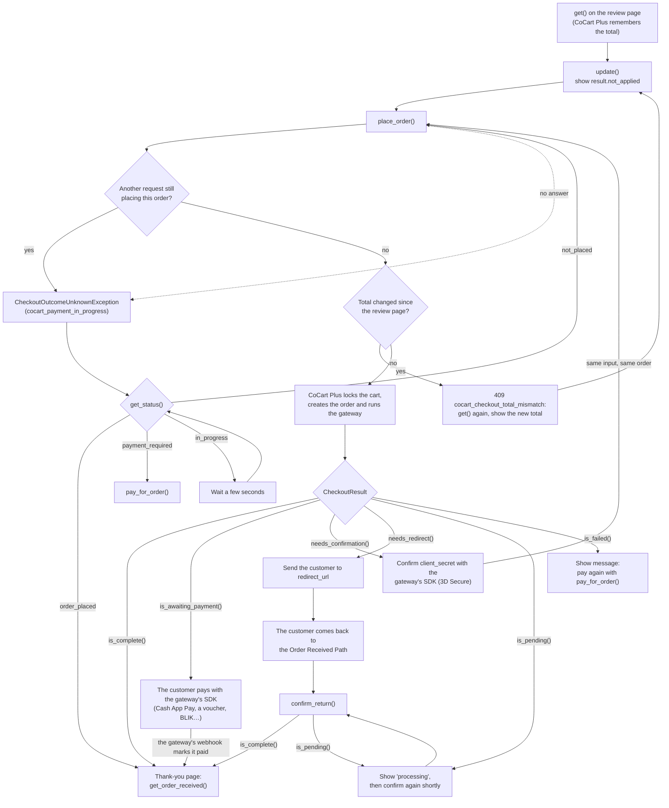

# Checkout

> Requires **CoCart Plus 2.0** and at least one WooCommerce payment gateway.

Checkout turns the customer's cart into an order and takes payment. Your Python code runs on the server, so **card details never reach it**:
- The browser collects the card with the gateway's own JavaScript (for Stripe, Stripe.js with your publishable key) and gives you a payment method ID.
- You place the order with that ID. `payment_data` only ever carries such gateway tokens, never card numbers.

- [How It Works](#how-it-works)
- [Quick Start](#quick-start)
- [Showing the Checkout](#showing-the-checkout)
- [Placing the Order](#placing-the-order)
- [Reading the Result](#reading-the-result)
- [3D Secure in the Page](#3d-secure-in-the-page)
- [Paying Outside the Checkout](#paying-outside-the-checkout)
- [Off-Site Steps](#off-site-steps)
- [Saved Payment Methods](#saved-payment-methods)
- [The Thank-You Page](#the-thank-you-page)
- [Paying for an Unpaid Order](#paying-for-an-unpaid-order)
- [Address Autocomplete](#address-autocomplete)
- [Errors Before Payment](#errors-before-payment)
- [When No Answer Comes Back](#when-no-answer-comes-back)
- [Changing a Subscription's Payment Method](#changing-a-subscriptions-payment-method)

## How It Works

1. **Show the checkout** on the page the customer reviews: the checkout itself (`get()`), the store's form settings (`get_config()`) and the payment methods (`get_payment_methods()`).
2. **Save what the customer enters** with `update()`, and show what it couldn't apply (`result.not_applied`).
3. **The browser turns the card into a payment method ID** with the gateway's JavaScript.
4. **`place_order()`** creates the order and takes payment.
5. **Act on the result:**

   | Result | What to do |
   |---|---|
   | `is_complete()` | Show the thank-you page (`get_order_received()`) |
   | `is_awaiting_payment()` | The order is placed; the customer pays with the gateway's SDK (a wallet, a voucher, BLIK…) |
   | `needs_confirmation()` | The browser confirms the card (3D Secure), then you make the same call again |
   | `needs_redirect()` | Send the customer off-site, then call `confirm_return()` when they're back |
   | `is_pending()` | The gateway hasn't confirmed yet: confirm again shortly |
   | `is_failed()` | Show `message`; the customer pays again with `pay_for_order()` |

The whole flow, including the lock CoCart Plus takes so that a double tap, or a request sent again, can't take payment twice:



The client never sends `place_order()` again by itself after a timeout, since it may already have run on the store. When no answer comes back, `place_order()` raises `CheckoutOutcomeUnknownException`: see [When No Answer Comes Back](#when-no-answer-comes-back).

The client uses the customer's cart session, so create it as for the cart. On a server, **use one client per customer** (per request, or per session): the client holds the cart key or login, so sharing one between customers would share their carts.

```python
from cocart import CoCart

client = CoCart("https://your-store.com", cart_key=cart_key)  # or jwt_token=token
```

## Quick Start

In the browser, with Stripe.js and your **publishable** key:

```js
const stripe = Stripe('pk_test_…');
const elements = stripe.elements({ mode: 'payment', amount: 2500, currency: 'eur', paymentMethodCreation: 'manual' });
elements.create('payment').mount('#payment-element');

// On submit:
await elements.submit();
const { paymentMethod, error } = await stripe.createPaymentMethod({ elements });
// POST paymentMethod.id to your server
```

On your server (Flask here):

```python
@app.post("/checkout")
def place_order():
    result = client.checkout().place_order({
        "billing_address": {
            "first_name": "Jane",
            "last_name": "Doe",
            "address_1": "1 Main Street",
            "city": "Paris",
            "postcode": "75001",
            "country": "FR",
            "email": "jane@example.com",
        },
        "shipping_method": "flat_rate:1",
        "payment_method": "stripe",
        "payment_data": {"wc-stripe-payment-method": request.form["payment_method_id"]},
    })

    if result.is_complete():
        return redirect(f"/thank-you?order={result.order_id}&key={result.order_key}")
    ...
```

## Showing the Checkout

Call `get()` for the page the customer reviews before paying. CoCart Plus remembers the total it showed, and refuses the order if the total has changed by the time it's placed (`409 cocart_checkout_total_mismatch`). So call it when you show that page, **not just before placing the order**: that would remember the new total and hide the change from the customer.

```python
checkout = client.checkout().get()

checkout.get("items")
checkout.get("totals.total")                # "2300", in minor units
checkout.get("total_lines")                 # display-ready lines
checkout.get("payment.needs_payment")       # False when the order is free
checkout.get("delivery.needs_shipping")
checkout.get("delivery.packages")           # each package with its rates and chosen_rate
checkout.get("customer.billing")
```

`get()` takes optional parameters: `currency` (prices in this currency, on a multi-currency store), `formatted` (amounts formatted for display, `"$23.00"`, instead of minor units) and `thumb` (`False` leaves each item's `featured_image` empty):

```python
checkout = client.checkout().get({"currency": "EUR", "formatted": True, "thumb": False})
```

Save what the customer has entered so far, without placing the order. The totals, taxes and shipping rates update to match:

```python
checkout = client.checkout().update({
    "billing_address": {"country": "FR", "postcode": "75001"},
    "shipping_method": "flat_rate:1",
    "coupon_code": "SPRING10",
    "coupon_action": "apply",   # or "remove"
})

checkout.get("result.code")     # "checkout_updated", or "checkout_partly_updated"
for skipped in checkout.get("result.not_applied") or []:
    print(skipped["field"], skipped["code"], skipped["message"])
```

What couldn't be applied is listed in `result.not_applied` (`checkout_partly_updated`); when nothing could be, it's an error and nothing changes. Every address field at fault is reported at once: see [Errors Before Payment](#errors-before-payment).

The store's form settings: fields, required fields per country, countries, whether guests can check out, and the terms. No cart needed:

```python
config = client.checkout().get_config()

config.get("fields.billing")
config.get("countries")
config.get("account")
config.get("order_received_url")              # where customers come back to after an off-site step
config.get("address_autocomplete.enabled")    # with "providers": [{"id", "name"}]
config.get("store.terms_text")                # "I agree to the terms and conditions & the privacy policy."
config.get("store.terms_links")               # [{"text", "url"}]: the words in terms_text to link
config.get("store.terms_url")
config.get("store.privacy_url")
```

The payment methods for this cart:

```python
for method in client.checkout().get_payment_methods().to_dict():
    print(method["id"], method["title"], method["test_mode"], method["supports"]["subscriptions"])
```

## Placing the Order

```python
result = client.checkout().place_order({
    "billing_address": {...},
    "shipping_address": {...},       # when it differs from billing
    "shipping_method": "flat_rate:1",
    "customer_note": "Leave at the door",
    "payment_method": "stripe",
    "payment_data": {"wc-stripe-payment-method": payment_method_id},
})
```

| Field | Notes |
|---|---|
| `billing_address` | `first_name`, `last_name`, `address_1`, `city`, `postcode`, `country` and `email` at least, plus what `get_config()` marks required |
| `shipping_address` | Same fields, when shipping goes elsewhere |
| `shipping_method` | A rate `id` from `get()`'s `delivery.packages` |
| `payment_method` | A gateway ID: `stripe`, `woocommerce_payments`, `paypal`, `bacs`, `cod`…; leave it out for a free order |
| `payment_data` | What the gateway needs, as a dict (below) |
| `customer_note` | Optional |
| `create_account`, `customer_password` | Create an account for a guest, when the store allows it |
| `checkout_id` | Optional: see [When No Answer Comes Back](#when-no-answer-comes-back) |

`payment_data` holds the keys the WooCommerce gateway reads, and only gateway tokens: never send card numbers.

| To… | Key | Value |
|---|---|---|
| Charge a new Stripe card | `wc-stripe-payment-method` | The payment method ID (`pm_…`) |
| Charge a new WooPayments card | `wcpay-payment-method` | The payment method ID |
| Charge a saved payment method | `wc-{gateway}-payment-token` | The saved method's `id` |
| Save the new card for later | `wc-{gateway}-new-payment-method` | `True` |

Offline gateways (`bacs`, `cheque`, `cod`) need no `payment_data`. A free order (`payment.needs_payment` is `false`) needs neither `payment_method` nor `payment_data`. Calling `place_order()` again for the same cart updates the same order rather than creating a second one.

## Reading the Result

`place_order()`, `pay_for_order()`, `confirm_return()` and `account().update_subscription_payment_method()` return a `CheckoutResult`, read from the response's `result`. A declined card is a result (`is_failed()`), not an exception.

```python
result = client.checkout().place_order(order)

if result.is_complete():
    ...  # Paid, free, or held for review or offline payment: show the thank-you page.
elif result.is_awaiting_payment():
    ...  # Placed, not paid yet: the customer pays with the gateway's SDK.
elif result.needs_confirmation():
    ...  # The card needs 3D Secure in the page.
elif result.needs_redirect():
    ...  # The payment needs an off-site step.
elif result.is_pending():
    ...  # The gateway hasn't confirmed yet: confirm again shortly.
else:
    print(result.message)     # "Your card was declined."
    print(result.error_code)  # "card_declined"
```

| Member | Meaning |
|---|---|
| `code` | `result.code`: `"order_placed"`, `"action_required"`, `"payment_pending"`, `"payment_failed"`, or `"payment_method_changed"` for a subscription. A value a store or gateway adds comes through as it is |
| `is_complete()` | `True` for `order_placed` (or `payment_method_changed`) with no action left for the customer |
| `is_awaiting_payment()` | `True` for `order_placed` with an action: the order is placed but the customer still pays ([Paying Outside the Checkout](#paying-outside-the-checkout)) |
| `needs_confirmation()` | `True` for `action_required` with a `client_secret`: an in-page step |
| `needs_redirect()` | `True` for `action_required` with an off-site address and no `client_secret` |
| `is_pending()` | `True` for `payment_pending` |
| `is_failed()` | `True` for `payment_failed` |
| `object` | The document returned: `"order"`, or `"subscription"` |
| `order_id`, `order_key`, `order_number`, `order_status` | The order, when `object` is `order` (`order_status` is its status code, e.g. `"processing"`) |
| `subscription_id` | The subscription, when `object` is `subscription` |
| `redirect_url` | The off-site step with `needs_redirect()`, otherwise the page to show once the payment is done. Only ever an `https` or `http` address: anything else in the response (a `javascript:` URL, another app's link) is left out |
| `client_secret`, `intent_type` | For [3D Secure in the page](#3d-secure-in-the-page), or a payment made in the page |
| `payment_method_type` | For `is_awaiting_payment()` with Stripe: `cashapp`, `wechat_pay`, `boleto`, `oxxo` or `multibanco` |
| `message` | A message for the customer, for every code: why it failed, or that the order was received |
| `error_code` | With `payment_failed`, CoCart's code to branch on (below) |
| `gateway_error_code`, `gateway_message` | The gateway's own code and message, for your logs |
| `action_type`, `action_data` | What the customer must do, as the gateway integration names it (e.g. `"stripe_confirm_payment"`), and what it needs |
| `response` | The raw `Response`: the order, or the subscription |

A result never prints its `client_secret` or `order_key`: `repr(result)` leaves them out, so logging a result doesn't leak them. Messages (`message`, `gateway_message`) are plain text: escape them as any text when you put them in a page.

A result without a `code` reads as `payment_failed`, never as complete.

| `error_code` | Meaning |
|---|---|
| `card_declined` | Declined, including for fraud |
| `insufficient_funds` | Not enough funds |
| `expired_card` | The card has expired |
| `incorrect_cvc`, `incorrect_number`, `incorrect_postcode` | Wrong details |
| `authentication_failed` | 3D Secure failed or was cancelled |
| `processing_error` | The gateway had a problem; try again |
| `payment_method_not_supported`, `amount_not_supported` | The gateway can't take this payment |
| `payment_failed` | The gateway didn't say why |

## 3D Secure in the Page

Send `result.client_secret` to the browser and confirm it with Stripe.js. Then make the same call again with the same input; it completes the same order.

```python
if result.needs_confirmation():
    return jsonify(client_secret=result.client_secret)
```

```js
const { error } = await stripe.handleNextAction({ clientSecret });
if (!error) {
  // Ask your server to place the order again.
}
```

## Paying Outside the Checkout

With some payment methods the order is placed before the customer pays, so `is_awaiting_payment()` is `True` rather than `is_complete()`. The cart has already been emptied. `action_type` says what to show, and the gateway's webhook marks the order paid. Don't place the order again.

- **Stripe wallets and vouchers** (Cash App Pay, WeChat Pay, Boleto, OXXO, Multibanco): send `client_secret`, `payment_method_type` and `redirect_url` to the browser, and pay with Stripe.js as the Stripe gateway's own checkout does:

  | `payment_method_type` | Stripe.js call |
  |---|---|
  | `cashapp` | `confirmCashappPayment(clientSecret, { return_url })`, or `confirmCashappSetup()` for a `seti_…` secret (a free trial) |
  | `wechat_pay` | `confirmWechatPayPayment(clientSecret, { payment_method_options: { wechat_pay: { client: 'web' } } })` |
  | `boleto`, `oxxo`, `multibanco` | `confirmBoletoPayment(clientSecret)`, `confirmOxxoPayment()` or `confirmMultibancoPayment()` |

- **BLIK** (`stripe_blik_confirmation_pending`): ask the customer to approve the payment in their banking app.
- **Other gateways** (Mercado Pago Pix and tickets, Mollie bank transfer…): `action_data` carries what to show, such as a QR code or bank transfer instructions.

`checkout().get_status()` says `payment_required` until the payment goes through, then `order_placed`. A voucher is paid later, at a bank or a shop. If the customer gives up, the order stays unpaid, and `pay_for_order()` takes another payment for it.

## Off-Site Steps

```python
if result.needs_redirect():
    return redirect(result.redirect_url)
```

The customer comes back to your thank-you page: the **Order Received Path** set in CoCart Plus under Settings → Checkout (`/checkout/order-received/{order_id}/` by default), on your **Front-end site URL**. Serve that path, and hand the URL to `confirm_return()` there. If the setting changes, change your route to match:

```python
result = client.checkout().confirm_return(request.url)

if result.is_complete():
    ...  # Show the thank-you page.
elif result.is_pending():
    ...  # Not confirmed yet: show "processing" and call confirm_return() again shortly.
else:
    print(result.message)  # Declined or cancelled: offer pay_for_order().
```

`confirm_return()` is safe to call more than once. It reads the order ID (`order_id`) and key (`key`) from the URL and forwards every query parameter to `confirm_order_payment()`, which sends the order key in the request body. If your route carries the order elsewhere: `confirm_return(url, order_id=123, order_key="wc_order_…")`.

`get_config()` gives the URL customers come back to as `order_received_url`, e.g. `https://shop.example.com/order/{order_id}?key={order_key}&order_id={order_id}`, so you know which route (or, in an app, which link) to handle.

A subscription's payment method change can send the customer off-site too (a bank, for example). They come back the same way, and the same return call finishes the change: `is_complete()` with `code` `payment_method_changed` and `object` `subscription` once the new payment method is set, failed when it wasn't confirmed.

## Saved Payment Methods

A logged-in customer's saved payment methods (empty for a guest):

```python
for saved in client.checkout().get_saved_payment_methods():
    saved["id"]                      # 7
    saved["gateway_id"]              # "stripe"
    saved["label"]                   # "Visa ending in 4242"
    saved["type"]                    # "CC"
    saved["expires"]                 # "12/2030", or None
    saved["is_default"]
    saved["supports_subscriptions"]  # the gateway can charge renewals

stripe_only = client.checkout().get_saved_payment_methods("stripe")  # one gateway only
```

Pay with one with `"payment_data": {"wc-stripe-payment-token": saved["id"]}`. To save a new card, add `"wc-stripe-new-payment-method": True`.

## The Thank-You Page

```python
order = client.checkout().get_order_received(order_id, order_key)

order.get("number")
order.get("status.label")           # "Processing"
order.get("items")
order.get("totals.total")
order.get("total_lines")            # display-ready lines
order.get("payment.needs_payment")  # True if the customer still has to pay
```

The key must match the order's: a wrong key, or someone else's order, is `404 cocart_order_not_found`. It takes optional `formatted` and `meta_keys` (only these keys in the order's `meta`; a list is comma-joined):

```python
order = client.checkout().get_order_received(order_id, order_key, {"formatted": True, "meta_keys": ["gift_message"]})
```

## Paying for an Unpaid Order

```python
result = client.checkout().pay_for_order(order_id, order_key, {
    "payment_method": "stripe",
    "payment_data": {"wc-stripe-payment-method": payment_method_id},
})
```

The order key goes in the request body, not the URL. It returns the same `CheckoutResult` as `place_order()`, and you read it the same way:

- a declined card is `result.is_failed()`, not an exception;
- a card that needs 3D Secure gives `result.needs_confirmation()`: confirm it as in [3D Secure in the Page](#3d-secure-in-the-page), then call `pay_for_order()` again;
- an off-site step gives `result.needs_redirect()`.

An order that needs no payment or can't be paid is a `409`, and so is another payment still running for it (`cocart_payment_in_progress`): both raise a `CoCartException`.

## Address Autocomplete

```python
found = client.checkout().search_addresses("10 Downing", country="GB")
suggestion = found.get("suggestions")[0]

details = client.checkout().get_address_details(suggestion["id"], found.get("provider.id"))
details.get("address")  # {"address_1": "10 Downing Street", "city": "London", ...}
```

The search needs at least 3 characters, and neither call needs a cart. Without a server-side address provider, the search is `404 cocart_address_search_no_provider`: check `get_config()`'s `address_autocomplete.enabled` first.

## Errors Before Payment

When the store refuses the order before trying to take payment, `place_order()` raises a `CoCartException` (a `ValidationException` for a `400`). Every address field at fault is reported at once:

```python
from cocart.exceptions import CoCartException

try:
    result = client.checkout().place_order(order)
except CoCartException as e:
    e.error_code    # e.g. "cocart_invalid_address_fields"
    e.get_fields()  # {"billing.postcode": "Enter a valid postcode.", ...}: show each next to its field
    e.get_field()   # "billing.postcode": the first field at fault
    str(e)
```

| Code | Meaning |
|---|---|
| `cocart_cant_checkout_empty_cart` | The cart is empty |
| `cocart_address_field_required`, `cocart_invalid_address_fields` | A required address field is missing or wrong |
| `cocart_invalid_email_address`, `cocart_invalid_phone_number` | Invalid email or phone |
| `cocart_invalid_billing_postcode`, `cocart_invalid_billing_country_code` | Invalid billing postcode or country |
| `cocart_invalid_shipping_postcode`, `cocart_invalid_shipping_country_code` | Invalid shipping postcode or country |
| `cocart_no_shipping_method`, `cocart_invalid_shipping_method` | No shipping method, or one that doesn't apply |
| `cocart_invalid_payment_method`, `cocart_payment_method_not_available`, `cocart_payment_method_disabled` | The payment method can't be used |
| `cocart_payment_method_no_subscription_support` | The cart has a subscription and the gateway can't renew it |
| `cocart_product_out_of_stock`, `cocart_insufficient_stock`, `cocart_product_not_purchasable`, `cocart_product_not_exists` | A product can't be bought any more |
| `cocart_invalid_coupon`, `cocart_coupon_usage_limit`, `cocart_coupon_email_restricted` | A coupon no longer applies |
| `cocart_account_exists`, `cocart_account_creation_failed` | `create_account` failed |
| `cocart_checkout_total_mismatch` (`409`) | The total changed since the customer reviewed it: call `get()` again and show the new total |
| `checkout_invalid_checkout_id` | The `checkout_id` you passed isn't 16 to 64 letters, digits, `-` or `_`. Raised before anything is sent |

A `409` is never a `ValidationException`, whatever its code says.

## When No Answer Comes Back

If the connection drops, the request times out or a proxy gives up waiting, the order may or may not have been placed. The same goes when another request is still taking payment for the cart (`409 cocart_payment_in_progress`: a double tap, or a request sent again after a timeout). Each order is sent with a random `checkout_id`, so `place_order()` raises `CheckoutOutcomeUnknownException` with that ID, and `get_status()` asks CoCart Plus how the checkout ended. Ask from the same cart, or as the same customer.

```python
from cocart import CheckoutOutcomeUnknownException

try:
    result = client.checkout().place_order(data)
except CheckoutOutcomeUnknownException as e:
    status = client.checkout().get_status(e.checkout_id)
    if status["code"] == "order_placed":
        ...  # It went through: show status["order_id"] with status["order_key"].
    elif status["code"] == "payment_required":
        ...  # Placed but not paid: pay_for_order(status["order_id"], status["order_key"], …).
    elif status["code"] == "in_progress":
        ...  # Still running: ask again in a few seconds.
    else:
        ...  # not_placed: nothing went through, place_order(data) again.
```

`get_status()` returns a dict with `checkout_id`, `code`, `message`, `order_id`, `order_key`, `order_number` and `order_status` (the order's status code); the order fields are `None` unless the checkout placed an order.

`CheckoutOutcomeUnknownException` keeps the original error's message and codes (`request_timeout`, `network_error`, the proxy's 502 or 504, or `cocart_payment_in_progress`). Pass your own `checkout_id` in the data (16 to 64 letters, digits, `-` or `_`) if you'd rather keep it yourself.

If the gateway's webhook paid the order after a 3D Secure confirmation in the page, placing the order again reports that order as complete rather than placing another.

## Changing a Subscription's Payment Method

See [Account](account.md#changing-a-subscriptions-payment-method).
